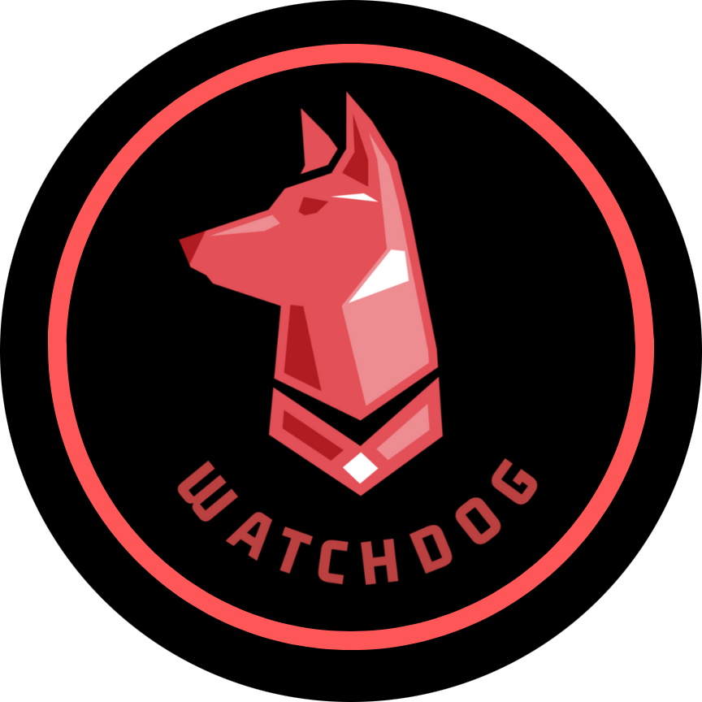

# WatchDog

**Most Promising Hack at StarterHacks 2024.** WatchDog listens to phone calls and emails for scams, and warns vulnerable people, such as seniors, while there's still time to hang up.



## How it works

1. Open the site and choose phone call or email detection.
2. Press play. The browser transcribes the call as it happens.
3. Each sentence goes to the Flask server, which matches it in context against common scam phrases.
4. The page updates a live scam score, so you can see the risk rising.

## Tech stack

| Part | Tools |
| --- | --- |
| Frontend | React, Vite, Tailwind CSS, Framer Motion |
| Backend | Python, Flask, NLTK |
| AI | OpenAI API for context matching |

## Run it locally

You'll need Node.js, Python 3 and an OpenAI API key.

```bash
# Add your key to the server's environment file
echo 'OPENAI_API_KEY=your_key_here' > server/.env

# Point the client at your local server
echo 'VITE_LOCAL_URL=http://localhost:5000' > client/.env.local

# Start the server
./server-mac.sh       # Windows: server-windows.bat

# In a second terminal, start the client
./client-mac.sh       # Windows: client-windows.bat
```

## Team

Built by [Vivek Manoj](https://github.com/viv500), Harishan Ganeshanathan, Prasun Sharma and Samyat Gautam.

## What's next

- Support for more languages
- A bigger database of scam patterns
- Integrations with more communication platforms
